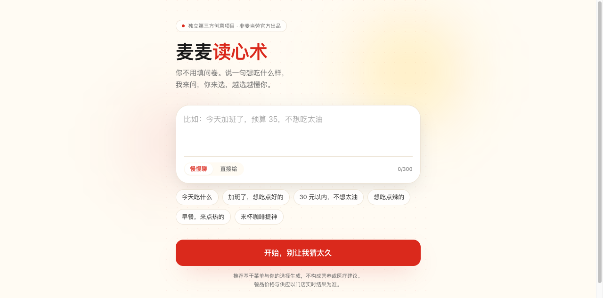
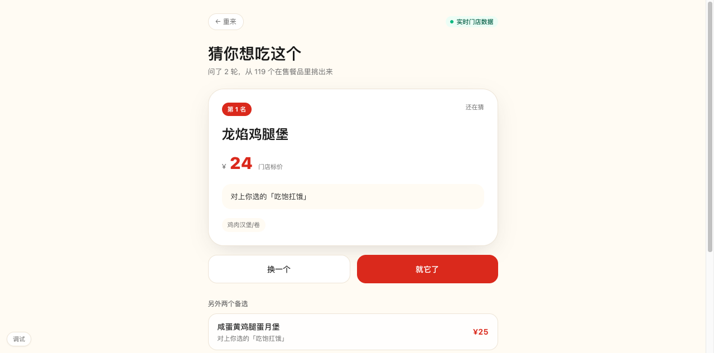

# 麦麦读心术 · MCD Mind Swipe

> 不让用户填问卷，让 AI 来问。两道题，猜出你今天想吃哪一口。

一个基于**麦当劳中国 MCP** 的餐品推荐 Skill：用户说一句想吃什么样，系统从真实门店在售菜单里筛出候选，再由一个「问题价值引擎」挑出**当前信息量最大**的二选一问题，几轮之内收敛到 Top 3，并解释为什么是它。

> 独立第三方创意项目，非麦当劳官方出品。推荐仅供参考，不构成营养或医疗建议。

---

## 它解决什么

| 常见困境 | 现有做法 | 本项目的做法 |
|---|---|---|
| 「今天吃什么」 | 让用户从几十个菜品里翻 | AI 先问一个能砍掉一半候选的问题 |
| 「30 元以内，不想太油」 | 用户自己一个个看价格 | 预算与忌口当**硬约束**过滤，不打折扣 |
| 「还是老样子」 | 每次重新选一遍 | 答过的题不再问，越用越短 |
| 选错了想反悔 | 只能重来 | 撤销一步，评分与后续问题同步回滚 |

核心区别：**问什么由算法决定，不由模板决定。** 同一个用户在不同候选集下会看到不同的问题，因为系统在算「这一问能把候选分得多开、能改变 Top 3 吗」。

---

## 效果

<!-- 截图占位，见 docs/ 目录 -->
| 首页 | 二选一 | 推荐结果 |
|---|---|---|
|  |  |  |

---

## 快速开始（离线可跑，无需任何凭证）

```bash
# 1. 后端
python3 -m venv .venv
./.venv/bin/pip install -r services/api/requirements.txt

cd services/api
../../.venv/bin/uvicorn app.main:app --port 8000

# 2. 前端（另开一个终端）
cd apps/web
npm install
npm run dev          # http://127.0.0.1:5173
```

默认 `MENU_PROVIDER=mock`，使用 `data/mock_menu.json` 里的 49 个示例菜品，界面会明确标注「示例菜单（非实时）」。

想要单端口访问（方便录屏）：先 `cd apps/web && npm run build`，后端会自动托管 `dist/`，访问 `http://127.0.0.1:8000` 即可。

---

## 接入真实门店数据

```bash
cp .env.example .env
# 填入 MCD_MCP_TOKEN（在 open.mcd.cn/mcp 用手机号登录后申请）
# 并把 MENU_PROVIDER 改成 mcp
```

Token 只在服务端进程内使用：不进入前端 bundle、不写入仓库、不出现在日志与截图中。

接入后界面右上角会变成「实时门店数据 · 麦当劳广州华夏路餐厅」，并展示门店实时价格；`/api/health` 也会返回 `mcp_token_configured: true`。

真实接入了哪些工具、调用链长什么样、返回结构有什么坑，全部写在 **[MCP_INTEGRATION.md](MCP_INTEGRATION.md)**。

---

## 它怎么工作

```
一句话输入
   ↓  规则解析（可选 LLM 增强，失败自动回退）
意图结构化：预算 / 口味 / 忌口 / 时段 / 情绪
   ↓  MenuProvider（Mock 或真实 MCP）
门店在售菜单 + 标签体系
   ↓
硬约束过滤：预算、忌口、不吃辣
   ↓
多属性打分：fit + personal + context + role − uncertainty
   ↓
问题价值计算：split_balance / expected_rank_change / relevance
   ├─ 有价值的问题 → 出二选一 → 更新偏好 → 回到打分
   └─ 分差够大 / 已问 5 轮 / 没问题值得问 → 直接给 Top 3
```

三个刻意的设计取舍：

1. **偏好不是累加器，是答题记录的派生值。** 每次从 `answers` 重算并带衰减（越新的选择权重越高），所以「撤销」只要删掉那条记录，分数天然回滚，不需要反向修正。
2. **「能不能当一餐」是独立先验。** 少了它，用户一说「清爽」，Top 3 全是咖啡和冰淇淋——这是我在联调时真实踩到的坑。
3. **没有营养数据就不谈营养。** 真实菜单只给名称和价格，此时解释器只说预算与口味，不编造「低脂」「健康」这类结论。

---

## 目录

```
mcd-mind-swipe/
├── apps/web/                  React + TS + Vite + Tailwind 客户端
│   └── src/{pages,components,stores,api}
├── services/api/              FastAPI 服务
│   └── app/
│       ├── engines/           intent / question / ranker
│       ├── providers/         mock / mcd_mcp / enrich
│       ├── models/            Pydantic 契约 + 持久层
│       └── routers/           session / profile / health
├── data/mock_menu.json        49 个示例菜品（营养值参考公开营养表）
├── tests/                     端到端契约测试
├── docs/                      截图与说明
├── MCP_INTEGRATION.md         MCP 工具、调用链、返回结构
├── mcp-config.example.json    脱敏配置（仅环境变量占位符）
└── .env.example
```

---

## API

| 方法 | 路由 | 说明 |
|---|---|---|
| POST | `/api/session/start` | `{input, mode}` → 首问或首推 |
| POST | `/api/session/{id}/answer` | `{question_id, choice, revision, request_id}` |
| POST | `/api/session/{id}/undo` | 撤销最后一步并重算 |
| GET | `/api/session/{id}/recommendations` | 当前推荐 |
| POST | `/api/session/{id}/feedback` | accept / dislike / not_today |
| GET / DELETE | `/api/profile` | 读取 / 删除长期偏好 |
| GET | `/api/health` | 状态（不含任何凭证） |

幂等：同一 `request_id` 重复提交返回当前状态；`revision` 落后的迟到响应会被拒绝，不允许覆盖新状态。

---

## 测试

```bash
cd services/api
../../.venv/bin/pytest -q
```

覆盖：空白输入可开始且提问封顶、预算与忌口为硬约束、无候选时给建议而非编造、幂等、撤销、过期 revision 拒绝、极速模式跳过提问、数据源标注。

---

## 数据与隐私

- 默认不落任何个人数据；`consent=false` 时不跨会话保留偏好。
- 长期偏好只有用户明确同意后才写入，且可通过 `DELETE /api/profile` 删除。
- 埋点只记匿名会话 ID 与聚合事件，不记原始文本、地址、订单。
- 不创建订单、不代付、不读取历史订单。

---

## 已知限制

- LLM 默认关闭，全部走规则引擎。规则对中文口语的覆盖有限（例如反讽、方言），这是明确的降级路径而非「假装智能」。
- 真实菜单缺少营养成分，此时营养相关维度按名称关键词粗判，解释中不会出现营养结论。
- 存储优先 SQLite；当运行目录不可写（只读挂载、沙箱）会自动降级为内存，`/api/health` 的 `storage` 字段会如实显示 `memory`，此时重启不保留会话。
- 单人场景。多人共同选餐在 V2 路线里，尚未实现。

---

## 许可

MIT。参考了公开的滑动点餐交互思路（见规划书附录 B），未复用其代码。
